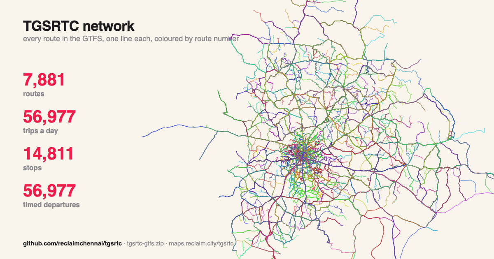
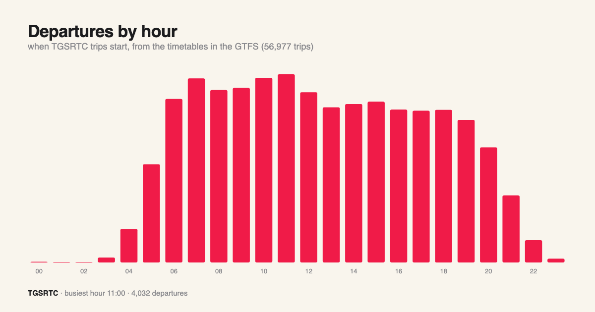
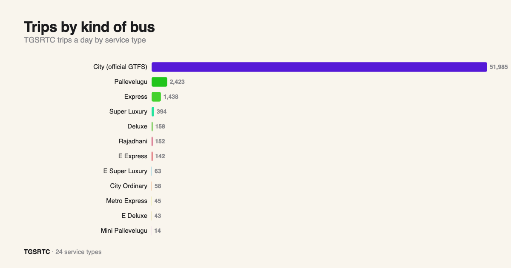
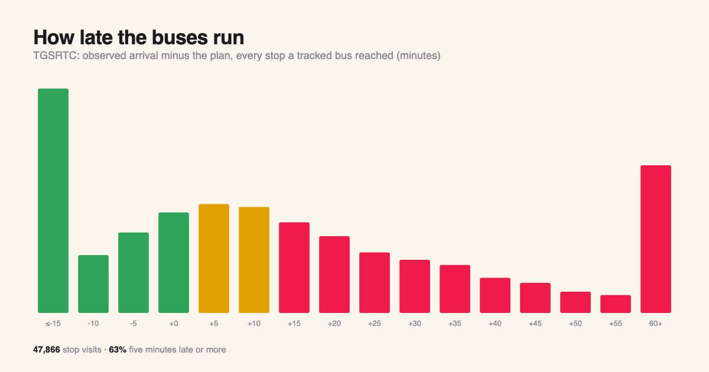
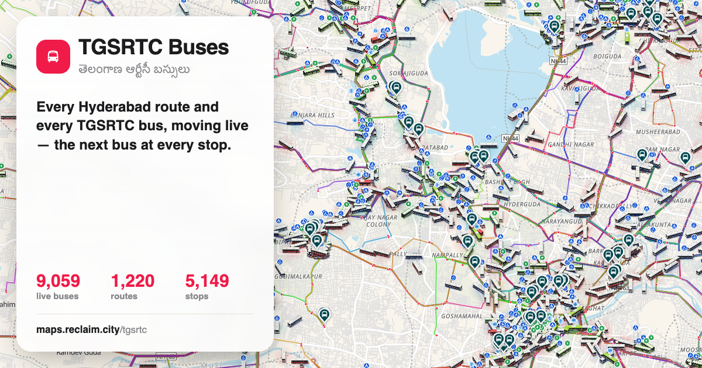
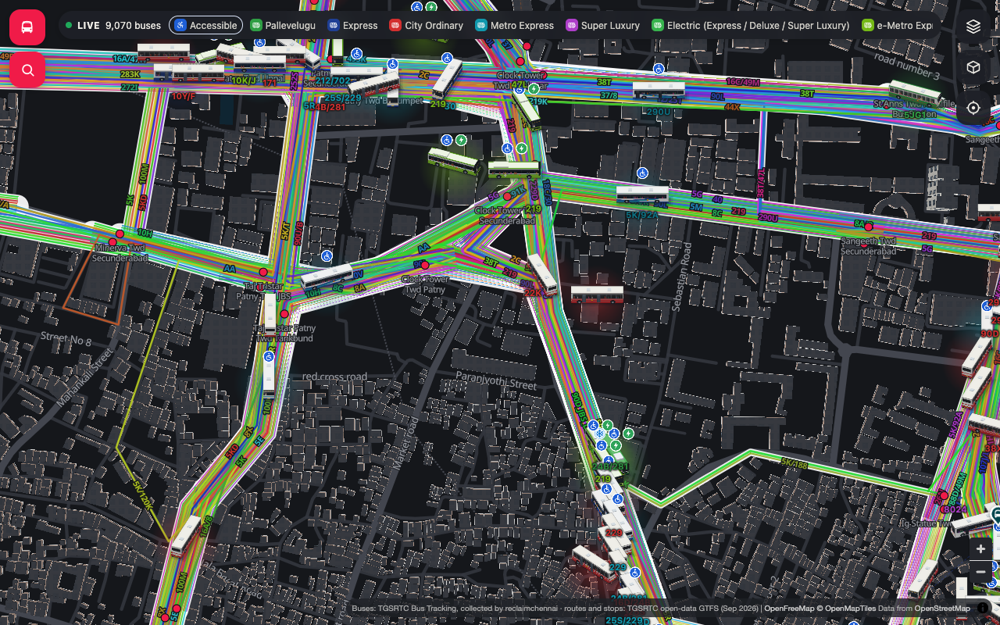
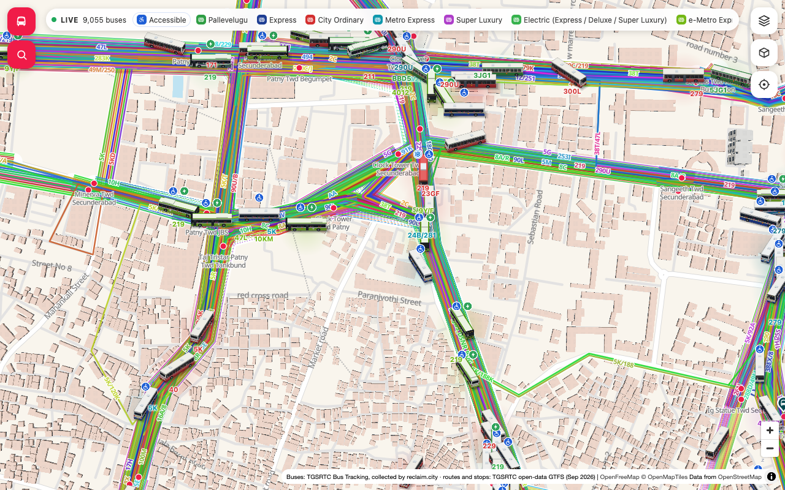
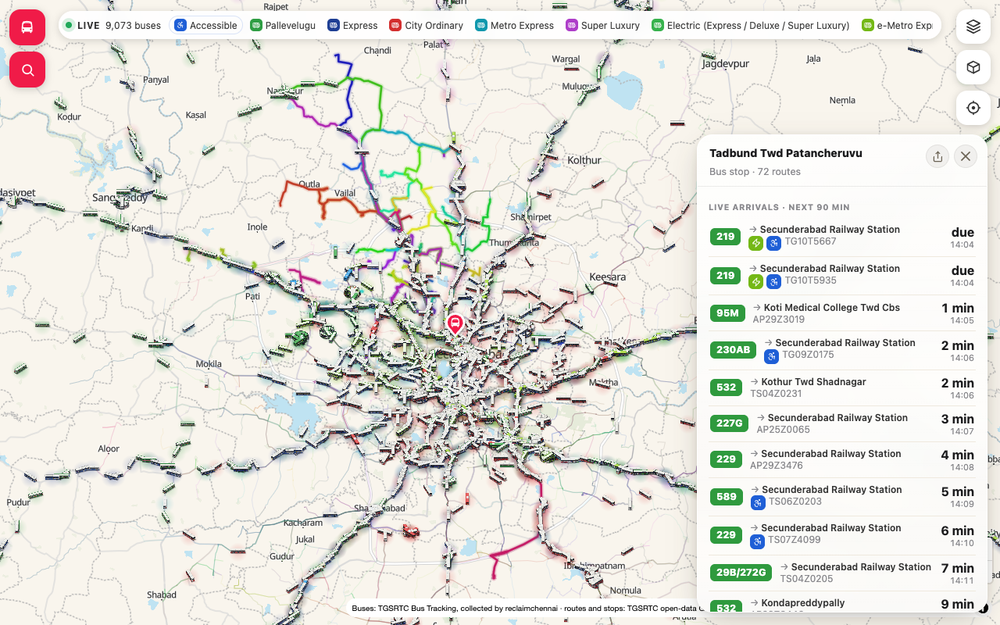

# TGSRTC — open bus data for Telangana

   

The official TGSRTC GTFS (Open Data Telangana) **joined with every service we have collected that it
does not carry** — mostly district and intercity buses — plus what the buses actually did. Collected by
**reclaim.city** for the live map at **[maps.reclaim.city/tgsrtc](https://maps.reclaim.city/tgsrtc/)**.



## What's in it

| File | What | Size |
|---|---|---|
| [`data/tgsrtc-gtfs.zip`](data/tgsrtc-gtfs.zip) | **The combined GTFS feed** | 7,881 routes · 56,977 trips · 14,811 stops · 1,373,631 stop times |
| `data/gtfs/` | the small GTFS files unzipped, to browse (stop_times and shapes are in the zip) | |
| [`data/trip_observations.csv.gz`](data/trip_observations.csv.gz) | per collected service-day and stop: **planned, arrived and left** (IST), route, service type, depot, bus | 110,943 rows |
| [`data/stats/`](data/stats/) | `punctuality_by_route.csv`, `punctuality_by_depot.csv` (median and 80th-percentile delay, % on time −2…+5 min, origin excluded), `coverage.csv` (trips, services, buses, routes, depots, stops logged per day) | |
| `data/web/` | the live map's own network files (stops, services, road segments) | |
| [`data/realtime/`](data/realtime/) | **GTFS-Realtime** samples: VehiclePositions and TripUpdates (`.pb`, and `.json.gz` to read) — see below | |
| `data/stats.json` | the numbers on this page | |
| `tools/` | how this repo is built (`build_tgsrtc.py`, `charts.py`, `readme.py`); the collectors are not published | |

### How it is built

- **The official feed is kept as published** (1,220 route numbers, 5,177 stops, Hyderabad city).
- **Collected services are added** when their route number is not in the official feed: 3,748 routes,
  4,992 trips, 9,634 new stops (ids prefixed `tgc-`), from the TGSRTC Bus Tracking service:
  each trip's stops with planned times and the bus's GPS line as its shape.
- **Stops are shared**: a collected stop within 100 m of an official stop with the same name uses the official `stop_id`.
- **De-duplicated**: one trip per service (its most complete record). The 827 collected services already in the
  official feed are not added again; what those buses did is kept in `trip_observations.csv.gz`.
- No driver data is in this repository, and none was ever collected into it.

## GTFS-Realtime

Standard **GTFS-RT 2.0** Protocol Buffer feeds, built from the same live data as the map, with ids that match the
static GTFS above: **VehiclePositions** (every live bus: position, bearing, speed, vehicle number, and its trip and
route where known) and **TripUpdates** (arrival time and delay at each stop still ahead).

| Feed | Sample in this repo | Snapshot |
|---|---|---|
| VehiclePositions | [`data/realtime/vehicle_positions.pb`](data/realtime/vehicle_positions.pb) (+ `.json.gz`) | 9,057 buses, 1,364 on a known GTFS trip |
| TripUpdates | [`data/realtime/trip_updates.pb`](data/realtime/trip_updates.pb) (+ `.json.gz`) | 559 trips |

How trips are matched: each bus's route number and service come from the TGSRTC tracking feed; collected district services are trip `tgc-<serviceId>`, and on official city routes the trip is the one whose timetable is nearest (within 3 min, and alone that near) to the bus's planned time at the same stop — otherwise the bus carries its `route_id` only; stop times ahead are our nowcast model's predicted arrivals. The generator is [`tools/gtfs_rt.py`](tools/gtfs_rt.py)
(`gtfs_rt.py index tgsrtc tgsrtc-gtfs.zip rt_index.json`, then `gtfs_rt.py serve …`); the samples are one snapshot.
Live feeds, refreshed every 30 s, are being switched on at `https://maps.reclaim.city/tgsrtc/rt/vehicle_positions.pb`
and `…/trip_updates.pb`.

## Use it

```bash
curl -LO https://github.com/reclaimchennai/tgsrtc/raw/main/data/tgsrtc-gtfs.zip
```

Load it into OpenTripPlanner, `gtfs-kit` / `partridge` (Python), `tidytransit` (R), or any GTFS tool.

## See it live

[maps.reclaim.city/tgsrtc](https://maps.reclaim.city/tgsrtc/) — every route and every live TGSRTC bus, the next bus
at every stop, timetables and how late they usually run.

## Statistics















## Licence

Data: [ODbL 1.0](LICENSE). Please credit **reclaim.city** and the sources above.

## Sources

| What | Source |
|---|---|
| city routes, stops, timetables, shapes | [Open Data Telangana](https://data.telangana.gov.in/) — TGSRTC GTFS, 25 Sep 2026 |
| district services, observed times | the public **TGSRTC Bus Tracking** service, collected by reclaim.city |
| roads (map segments) | OpenStreetMap, routed with OSRM |

### Limitations

- Collected services are added from the days they were seen running; one calendar (`daily`) is used for them.
- Planned times for collected services are TGSRTC's own; observed times are in `trip_observations.csv.gz`.
